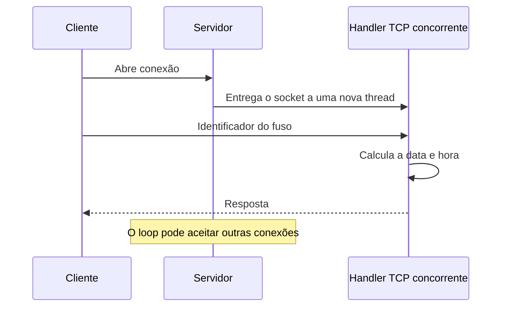

# Relógio Mundial — sockets TCP e UDP

**Três implementações da mesma consulta para comparar protocolos e atendimento concorrente.**

Projeto acadêmico de Sistemas Distribuídos em Java. O cliente informa um identificador de fuso, como `America/Sao_Paulo`, e recebe a data e a hora calculadas pelo servidor com `ZonedDateTime`.

## As três versões

| Pasta | Transporte | Modelo de atendimento |
| --- | --- | --- |
| [udp-clock](udp-clock/) | UDP | Requisição e resposta por datagramas. |
| [tcp-clock-simple](tcp-clock-simple/) | TCP | Atendimento sequencial de conexões. |
| [tcp-clock-multithread](tcp-clock-multithread/) | TCP | Uma thread `ClientHandler` para cada conexão aceita. |

O objetivo é observar a comunicação entre processos e a diferença entre aceitar uma conexão e processar uma solicitação. Não é um serviço de sincronização de relógios: a referência temporal é o relógio da máquina que executa o servidor.

## Executar

Requisito: JDK 17 ou superior, conforme o ambiente descrito no projeto. Não há instalação de framework ou banco de dados.

```bash
git clone https://github.com/dlr-1337/relogio-mundial-sockets.git
cd relogio-mundial-sockets
```

Escolha uma pasta e compile os arquivos dela:

```bash
cd udp-clock
javac -encoding UTF-8 *.java
```

Abra dois terminais **na mesma pasta da versão escolhida** e execute o servidor antes do cliente:

| Versão | Terminal do servidor | Terminal do cliente |
| --- | --- | --- |
| UDP | `java ClockServerUDP` | `java ClockClientUDP` |
| TCP sequencial | `java ClockServerTCP` | `java ClockClientTCP` |
| TCP concorrente | `java ClockServerTCPMultithread` | `java ClockClientTCP` |

Nas versões TCP, compile primeiro com `javac -encoding UTF-8 *.java` dentro de `tcp-clock-simple` ou `tcp-clock-multithread`. Os clientes TCP de mesmo nome pertencem a pastas diferentes; não misture suas classes.

Para explorar concorrência, abra vários clientes da versão multithread. Seu servidor escuta na porta **9878** e registra o nome da thread atribuída a cada conexão.

## Exemplo de consulta

Quando o cliente solicitar o fuso, informe um identificador reconhecido pelo Java:

```text
America/Sao_Paulo
Europe/London
Asia/Tokyo
UTC
```

O horário varia conforme o instante da consulta. Esses valores são entradas de exemplo, não saídas fixas esperadas.

## Como funciona



Na versão sequencial, o processamento acontece antes de voltar ao `accept()`. Na concorrente, a leitura e a resposta são delegadas ao handler, enquanto o loop principal continua aceitando conexões.

**Concorrência tem custo:** uma thread por conexão não implica escalabilidade ilimitada nem desempenho sempre superior. Há consumo de memória, escalonamento e limites do sistema operacional. Latência e capacidade exigem medição; este repositório demonstra os modelos, não apresenta um benchmark comparativo.

## Organização e exploração

- `ClockServer*`: inicialização do socket e atendimento ou delegação.
- `ClockClient*`: entrada do usuário e troca de mensagens.
- `ClientHandler`: processamento da conexão na versão concorrente.
- `java.net`, `java.io` e `java.time`: rede, entrada/saída e cálculo temporal.

Para a demonstração, utilize a própria máquina ou uma rede de laboratório autorizada. Pare os servidores com `Ctrl+C` ao terminar e confira host e porta no código antes de usar computadores diferentes.

**Autor:** Otávio · **Disciplina:** Sistemas Distribuídos · **Atividade:** março de 2026.
